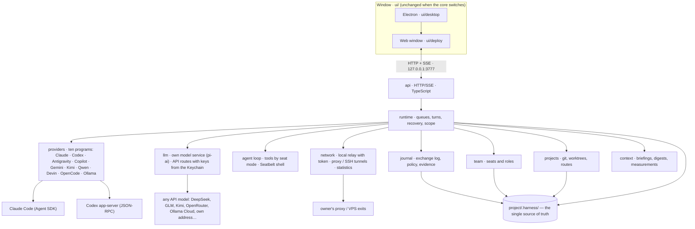
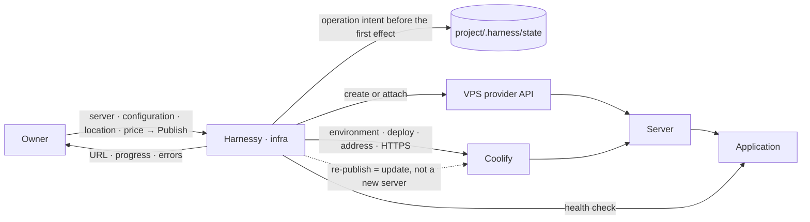

# Harnessy

The owner's window over a team of AI agents: roles (seats) with their own instructions, a shared exchange journal with delivery cursors, an exchange policy, context hand-off between agents, and the owner's veto on everything that has consequences. One repository, two parts:

- **`packages/`** — the running TypeScript core (Node 22, strict TS, tests next to the code): `providers`, `llm`, `journal`, `team`, `projects`, `context`, `runtime`, `api`. See `packages/README.md` for the rules and the module map.
- **`ui/`** — the window: design code and screen sketches (`ui/sketches/disarto`), the prototype with the live layer (`ui/deploy`), and the Electron shell (`ui/desktop`). The window is kept as is; the core must serve the same HTTP/SSE contract.

The Python engine is preserved in Git history under the `mvp-python` tag. Running the engine requires Node.js, not Python; the separate UI build still uses Python.

Русская версия: [README.ru.md](README.ru.md).

## Architecture at a glance



## Run (today)

```bash
~/Harnessy/ui/desktop/run.sh          # engine on 127.0.0.1:3777 (needs `claude login` and a Codex login)
~/Harnessy/ui/desktop/electron.sh # Electron window; it starts the engine itself if the port is silent
npm test                        # strict build of all packages + tests
```

## Six architecture questions

Status marks: **[code]** — merged into `main` and covered by tests; **[contract]** — agreed in `packages/tasks/TS-0N.md`, implementation in progress.

### 1. Is there a single source of truth for project state?

**Yes: the project folder.** Everything about a project lives in `<project>/.harness/` as plain files, formats retained from the Python-era engine **[code]**:

| file | holds |
|---|---|
| `team.yaml`, `roles/*.md` | seats, their vendor/model/mode, role instructions and specializations |
| `comms-policy.yaml` | who may write to whom, which kinds, triggers, who may observe whom |
| `state/channel.ndjson` | the exchange journal: append-only, first record is the protocol, `fsync` on every append |
| `state/cursors.json` | per-seat delivery cursors (what each seat has already received) |
| `state/chats.json`, `state/panes.json` | chats with full text and the seats' provider sessions/settings |
| `state/halt.json`, `state/attempts.json`, `state/seat-materialization.json`, `state/ack-events.json` | the owner's stop switch and the durable receipts of unfinished operations (see 2) |
| `MEMORY.md`, `evidence/` | project memory read into role briefings; review and test reports |

Process memory is a cache of these files: the runtime rebuilds panes, chats, cursors, pending owner confirmations and unfinished operations from them on every open. Models remember through their own provider sessions; the core stores only the session identifiers. Owner-level preferences (settings, pins, known projects, connection routes, API routes, proxy and VPS exits) live in `~/.harness-*.json`, outside any project; API keys and proxy passwords live in the macOS Keychain, never in files. There is no database for project state; exit statistics are kept as minute aggregates in the engine's own SQLite file.

### 2. How are unfinished operations saved and restored?

**Durable intent before the effect, durable receipt after it, and "uncertain" is a first-class state** **[code]** for turns and role assignments, **[code]** for owner confirmations and merges (TS-04c, merged):

- **A model turn.** Before the provider is called, the runtime writes an *attempt* (`attempts.json`: turn id, journal records delivered, start time). After the provider answers, the answer is written into the chat as a result record carrying `deliverySeq` and a receipt (`runtime: {turnInstanceId, recordSeqs, effectsPending, interrupted, nextSeen}`), then the journal cursor advances, then after-turn effects run, then the seat is saved, and only then the receipt is marked complete. On reopen the runtime finishes whatever stage was cut, **without calling the model again**.
- **Failure after the model may have acted** (transport lost, process crash, project closed) leaves the attempt as `uncertain`: the queue is not advanced, the seat is blocked for automatic re-delivery, the owner sees a note, and only the owner's next action to that seat releases it. Two restarts in a row or a message from another agent do not re-run the model.
- **A role assignment** is an operation record (`seat-materialization.json`) written before the first effect with the full normalized input (role, vendor, model, mode, specialization, chosen instructions, expected seat file) and stage marks (team, seat file, chat, status, briefing). A repeat completes only the missing stages, accepts only its own seat file, never duplicates the briefing and never guesses the initiator.
- **Owner confirmations and merges (TS-04c, contract).** A merge intent (original HEAD, full SHA, branch, chosen verdict, initiator) is written under the git lock before git is touched; after a restart it is compared with git: a proven merge gets its result and status, an ambiguous one becomes a typed uncertain state with no automatic re-merge. A recorded owner decision on a confirmation card is finished as recorded, never re-chosen.
- Journal write failures are recoverable: a truncated last line never swallows the next record, and owner-ack decisions are published through `ack-events.json` so a repeat does not deliver twice.

### 3. Where are the boundaries of an agent's authority?

- **Policy** (`comms-policy.yaml`): routes define which seat may send which kinds to whom; `observe` defines whose chats a role may read; records that require the owner's confirmation wait with `ack: pending` until the owner allows or rejects them **[code]**.
- **Turn scope** **[code]**: every turn gets an immutable `TurnScope {projectDir, seatId, turnInstanceId}`; the agent's tools are closed over it and refuse with `turn_ended` once the turn is over, cancelled or the project changed. The sender is never taken from tool arguments.
- **Process tokens** **[code]**: a Codex process gets a per-process secret; the HTTP bridge maps token → seat → active scope and rejects foreign or revoked tokens (`token_invalid`) and idle processes (`turn_ended`); the scope is re-checked right before each protected effect, after all awaits.
- **Mandate** **[code]**: an orchestrator may create a seat only inside a turn that started from the owner's own record, taken from an immutable snapshot of the turn's records.
- **Permissions and files** **[code]**: a seat's mode (chat / read / check / web / ask / edit / all) is mapped to the provider's canonical permission set; writable roots are the project root or the seat's own worktree; risky actions raise an approval card to the owner.
- **Merging** **[code]**: only roles listed in `mergeRoles` and the owner, only a SHA with an accepted verdict, only on the integration branch with a clean tree.
- **The owner's switch** **[code]**: `halt` interrupts running turns and holds every queue; only the owner can lift it.

### 4. How are actions with external consequences separated from text generation?

The model produces text and events; it does not touch the world directly.

- **Through the core only.** Sending to another seat, asking it, reading its chat, assigning a role and merging exist solely as tools that the core implements (`PeerTools` → `RuntimeActions`). Each goes through the journal's policy checks and the owner-confirmation gate, and re-validates the turn scope immediately before the effect **[code]** (merge and ask: TS-04c **[code]**).
- **Provider-side effects** (edits, commands) are governed by the provider's permission mode and sandbox chosen from the seat's mode, by writable roots, and by approval cards the owner answers in the window **[code]**.
- **Receipts, not retries.** Because external actions are not idempotent, the core never re-runs a turn whose outcome is unknown (see 2). A result that was received but whose local bookkeeping failed is kept and completed; a result that may have happened is left to the owner.
- **Hand-off carries text only.** When a conversation moves between seats or projects, only the text and its metadata move; execution receipts stay with the seat that produced them **[code]**.

### 5. Can a provider be replaced without changing the runtime?

**Yes, and there are now two kinds.** The runtime depends on one interface, `Provider` in `@harnessy/providers`: `runTurn(seat, message, ctx)`, `listSessions`, `sessionMessages`, `auth`, `models`, `reset`, `close`, with a `TurnContext` the runtime supplies (abort signal, event publisher, approval callback, session and handle callbacks, proxy environment, role note, peers, tools, process-token registry, writable roots, `modelStarted`). Providers are injected as `RuntimeDeps.providers[vendor]` **[code]**.

- **Programs** (their own login, their own tools): Claude (Agent SDK), Codex (app-server JSON-RPC), Antigravity, GitHub Copilot, Gemini CLI, Kimi Code, Qwen Code, Devin, OpenCode and local Ollama. The provider catalog (`/api/providers/catalog`) reports installation, login, models and which seat modes each program honestly supports; nothing is guessed **[code]**.
- **API models** (TS-21): `@harnessy/llm` is Harnessy's own streaming model service on `@earendil-works/pi-ai`. The owner connects any provider from the catalog or an own address (“Connect via API”), the key goes to the macOS Keychain and never into settings, models are discovered on request. The turn runs in Harnessy's own agent loop (`runtime/api-agent`): tools by seat mode (chat / read / edit / all / ask / check / web), paths only inside the project, shell under a macOS Seatbelt profile, reflected keys redacted before they reach the chat **[code]**. No Codex or other program stands in between.

Adding another first-class program means implementing the interface and registering it; the turn, queue and recovery logic stay untouched. A fallback Codex transport over `@openai/codex-sdk` remains planned behind the same interface.

### 6. How is the desktop shell connected to the backend and the packages?

- **Electron is a thin shell** (`ui/desktop`): `main.js` opens `http://localhost:3777/sketches/proto/10-new-chat.html`, checks `/api/status`, and if the port is silent starts the engine itself (`run.sh`) and waits. The renderer runs with context isolation and no Node; the only native bridge is `window.harnessy.pickFolder` (preload) for the Finder folder picker **[code]**.
- **The window is a web app** served by the engine itself from `ui/deploy/out/site` under `/sketches`: the live layer (`live.js`, `cx.js`, `ctx.js`, `set.js`, `conn.js`, `llm.js`, `network.js`, `network-add.js`, `network-recovery.js`, `network-stats.js`) talks to the engine over HTTP and SSE (`/api/events`) on `127.0.0.1:3777`. Requests are protected by Host/Origin/`Sec-Fetch-Site`/Content-Type checks so a foreign page in the browser cannot drive the engine **[code]**.
- **Backend = packages.** Since 09.10.2026 the live engine is TypeScript (`packages/api/bin/harnessy.ts`). The launcher `ui/desktop/run.sh` starts Node. The `api` package serves the existing HTTP/SSE contract; the root `/` redirects to the prototype entry `/sketches/proto/10-new-chat.html`. The former Python engine is available in Git history (`mvp-python`).

## Roadmap: publishing, connecting models, payments and learning **[plan]**

Two infrastructure services inside Harnessy, under the same rules as the core: intent before effect, operation state in files, paid actions only after explicit confirmation. In the module map these are `network` (built into `projects`, `runtime` and `api`: exits, relay, tunnels, statistics; partner reseller still planned) and `infra` (0.6: partners, VPS, deployment).

### Publishing projects

**What the owner sees:** server, configuration, location, price → one "Publish" button → step-by-step progress → the URL. A later publication updates the application on the same server; no new server is created.

**What Harnessy does:** creates or attaches a VPS, prepares the environment, deploys the application, sets up the address and HTTPS, verifies that it works, shows the URL.

| layer | with | role |
|---|---|---|
| server | the VPS provider's API | create, attach, delete the server |
| publishing | Coolify — API and CLI [1][2] | the deployment execution layer behind Harnessy's own interface |
| application | a Git repository with a Dockerfile | what exactly is published |
| accounts | the user's own account at the provider | MVP: one provider; selling infrastructure inside Harnessy comes later via a reseller programme |



### Proxy and VPS for models

**Built (TS-22, TS-23 · [code]).** On “Connections” the owner has a **Proxy and VPS** tab and, in each provider's card, a block “Through what we connect”:

- **Add** in two steps: a proxy by address (URL or login and password) or an own VPS over SSH (server address, a key picked from `~/.ssh`); one “Check” brings up the tunnel or connection and answers “Works · country · address · ms”.
- **Per provider** — direct (the service sees your address) or through an added proxy/VPS, with a reserve **in the same country only**, rotation every N minutes, and “stop the turn and ask me” instead of ever falling back to a direct connection silently.
- **Under the hood:** a local relay on `127.0.0.1` per provider with a per-launch 256-bit token (HTTP and CONNECT), SSH tunnels supervised by the engine (key copied to a private 0600 file, tunnel killed when the engine dies), a turn pinned to one exit, automatic retry on the reserve only before the model answered or ran a tool.
- **Statistics** per proxy and per provider × proxy — traffic, speed, latency p50/p95, availability, drops, 429/blocks, IP and country changes, time on the reserve, price — as a light card summary and a **Proxy** tab in “Spend and limits”; no destination addresses or contents are stored.
- **Check through the exits** — an owner-confirmed table “provider × exit” with the price shown before anything is called.

Contract: `packages/projects/NETWORK.md`; plan: `packages/tasks/TS-22.md`, `TS-23.md`; screens: sketch 25.

**Still a plan.** Issuing separate accesses from a partner Reseller API — DataImpulse, NSTData [3][4]: a separate access per user, a traffic cap, usage statistics; accounting of proxy traffic apart from model access and infrastructure. Master partner keys stay on the backend.

| layer | with | role |
|---|---|---|
| access | a partner Reseller API — DataImpulse, NSTData [3][4] | issue a separate access per user, cap traffic, collect statistics |
| exit type | ISP/static, residential sticky; mobile when needed | the primary options for testing |
| keys | master partner keys stay on the backend; the user gets a limited access | secrets never leave the server |
| accounting | model access, proxy traffic and infrastructure — separately | no mixed bills |

### Paying for subscriptions and APIs, turnkey accounts

**What the owner sees:** in "Connections", next to a provider — "Get a subscription / API key" and "Set up an account for me": pick the provider and plan, see the price with the fee, confirm — and a working login appears at the seat without manual hassle.

**What Harnessy does:** pays for the model subscription or API key through a partner, registers the account turnkey when needed (creating or buying an e-mail, a phone number, receiving verification codes, attaching a payment card), hands the credentials to the user and stores them the way the `claude`/`codex` programs store their logins today — the core holds no keys.

| layer | with | role |
|---|---|---|
| payment | a partner for paying model subscriptions and APIs (to be found) | process the payment where direct payment is unavailable; Harnessy fee |
| account | e-mail, number, verification codes, card — via partner services | turnkey registration; nothing happens without the owner's confirmation |
| accounting | subscriptions, API keys, accounts — separate lines | no mixing with proxy or servers |
| acceptable use | each provider's rules | checked before ordering; Harnessy does not promise to bypass restrictions |

### Learning

**What the owner sees:** a "Learning" section in the window and on the site: articles, videos and presentations on working with Harnessy (first launch, team and roles, journal and verdicts, publishing), plus two courses — vibe coding and AI for a product owner.

**What Harnessy does:** keeps the materials together with the product — every new capability gets an article and a short video; the courses are built from the same scenarios as the acceptance (our own team's work inside Harnessy); the materials live outside the core and are updated with releases.

| format | what |
|---|---|
| articles | step-by-step scenarios of the window and the core, answers to owners' questions |
| videos | short recordings of real walks along the user paths |
| presentations | product overview for teams and partners |
| "vibe coding" course | how to give tasks to a team of agents, read the journal, accept milestones |
| "AI for the owner" course | models, subscriptions, context, spending, safety — on Harnessy examples |

### Common principles

- Paid actions only after explicit confirmation.
- Operation state lives in files; progress and errors are visible; a resource is never bought twice.
- "Delete the application" and "delete the server" are different actions.
- Models, proxy traffic and servers are accounted separately.
- An exit country is not a guarantee of access to an AI service; compatibility and acceptable use are verified per provider.

Sources: [1] Coolify Docs, List resources — https://coolify.io/docs/api/endpoints/resources/list-resources · [2] coollabsio/coolify-cli — https://github.com/coollabsio/coolify-cli · [3] DataImpulse, Reseller API — https://help.dataimpulse.com/en/articles/15931714-reseller-api-managing-sub-users-and-traffic · [4] NSTData, Proxy Reseller Program — https://www.nstdata.io/resell · [5] VPS providers with partner APIs — https://www.perplexity.ai/search/80ea31d4-d563-4a34-ae4c-78bbee15e87d

## Where to look

- `packages/README.md` — rules of the new core, storage principle, module map, the main acceptance scenario (our own team's work reproduced inside Harnessy).
- `packages/tasks/TS-NN.md` — the outcome tables and contracts each package was built against (TS-20 program catalog, TS-21 API models, TS-22/TS-23 proxy and VPS).
- `packages/projects/NETWORK.md`, `packages/llm/README.md` — contracts of exits/relay/statistics and of the model service.
- `packages/api/src/bootstrap.ts` — engine startup and the root window.
- `mvp-python` — the historical Python engine and its behaviour tests.
