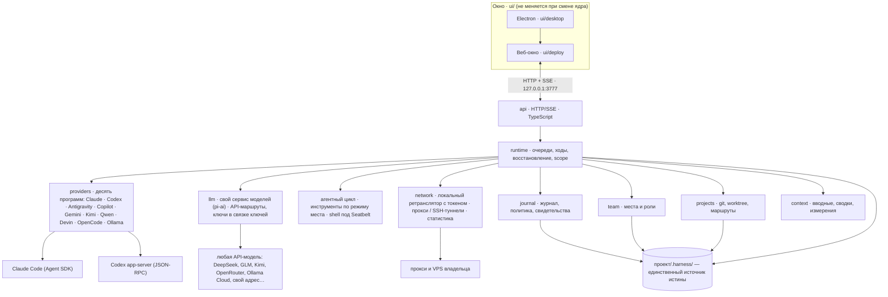
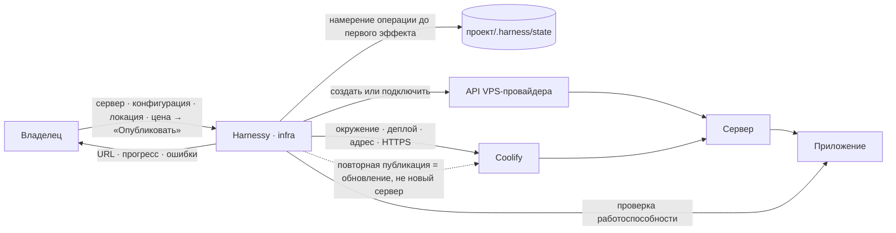

# Harnessy

Окно владельца над командой ИИ-агентов: роли (места) со своими инструкциями, общий журнал обмена с курсорами доставки, политика обмена, передача контекста между агентами и право вето владельца на всё, что имеет последствия. Один репозиторий, две части:

- **`packages/`** — работающее ядро на TypeScript (Node 22, строгий TS, тесты рядом с кодом): `providers`, `llm`, `journal`, `team`, `projects`, `context`, `runtime`, `api`. Правила и карта модулей — `packages/README.md`.
- **`ui/`** — окно: дизайн-код и эскизы экранов (`ui/sketches/disarto`), прототип с рабочим слоем (`ui/deploy`), оболочка Electron (`ui/desktop`). Окно не переписывается: ядро обязано отдавать тот же HTTP/SSE-контракт.

Python-движок сохранён в истории Git под тегом `mvp-python`. Для работы движка нужен Node.js; Python используется отдельно при сборке окна.

English version: [README.md](README.md).

## Архитектура одним взглядом



## Запуск (сегодня)

```bash
~/Harnessy/ui/desktop/run.sh          # движок на 127.0.0.1:3777 (нужны `claude login` и вход Codex)
~/Harnessy/ui/desktop/electron.sh # окно Electron; если порт молчит, оно само поднимает движок
npm test                        # строгая сборка всех пакетов + тесты
```

## Шесть вопросов об архитектуре

Пометки: **[код]** — влито в `main` и покрыто тестами; **[договор]** — согласовано в `packages/tasks/TS-0N.md`, реализация идёт.

### 1. Один ли источник истины у состояния проекта?

**Да: папка проекта.** Всё о проекте лежит в `<проект>/.harness/` обычными файлами, форматы сохранены со времени Python-движка **[код]**:

| файл | что хранит |
|---|---|
| `team.yaml`, `roles/*.md` | места, их вендор/модель/режим, инструкции ролей и специализации |
| `comms-policy.yaml` | кто кому может писать, какие виды записей, триггеры, кто кого наблюдает |
| `state/channel.ndjson` | журнал обмена: только дописывание, первая запись — протокол, `fsync` на каждую запись |
| `state/cursors.json` | курсоры доставки по местам (что каждое место уже получило) |
| `state/chats.json`, `state/panes.json` | чаты с полным текстом; сессии и настройки мест у провайдеров |
| `state/halt.json`, `state/attempts.json`, `state/seat-materialization.json`, `state/ack-events.json` | выключатель владельца и долговечные квитанции незавершённых операций (см. 2) |
| `MEMORY.md`, `evidence/` | память проекта, читаемая во вводные ролей; отчёты ревью и прогонов |

Память процесса — кэш этих файлов: при каждом открытии проекта движок восстанавливает из них места, чаты, курсоры, ожидающие подтверждения владельца и незавершённые операции. Модели помнят через свои сессии у провайдеров; ядро хранит только их идентификаторы. Настройки владельца (параметры, закреплённое, известные проекты, маршруты подключений, API-маршруты, прокси и VPS) — в `~/.harness-*.json`, вне проектов; ключи API и пароли прокси — в связке ключей macOS, не в файлах. Базы данных состояния проекта нет; статистика выходов хранится минутными агрегатами в собственном SQLite-файле движка.

### 2. Как сохраняются и восстанавливаются незавершённые операции?

**Долговечное намерение до эффекта, долговечная квитанция после него, «неопределённо» — полноценное состояние** **[код]** для ходов и назначений ролей, **[код]** для подтверждений владельца и слияний (TS-04c):

- **Ход модели.** До вызова провайдера движок пишет *попытку* (`attempts.json`: id хода, доставленные записи журнала, время старта). После ответа провайдера ответ записывается в чат как запись результата с `deliverySeq` и квитанцией (`runtime: {turnInstanceId, recordSeqs, effectsPending, interrupted, nextSeen}`), затем продвигается курсор журнала, затем выполняются эффекты после хода, затем сохраняется место — и только после этого квитанция помечается завершённой. При открытии движок доводит оборванный этап **без повторного вызова модели**.
- **Отказ после того, как модель могла подействовать** (обрыв транспорта, падение процесса, закрытие проекта) оставляет попытку в состоянии `uncertain`: курсор не продвигается, автоматическая доставка месту заблокирована, владелец видит заметку, и только его следующее действие к этому месту снимает блок. Два перезапуска подряд или запись другого агента модель не запускают.
- **Назначение роли** — запись операции (`seat-materialization.json`) до первого эффекта с полным нормализованным входом (роль, вендор, модель, режим, специализация, выбранные инструкции, ожидаемый файл места) и отметками этапов (команда, файл места, чат, статус, вводная). Повтор доводит только недостающие этапы, принимает только свой файл места, не дублирует вводную и не угадывает инициатора.
- **Подтверждения владельца и слияния (TS-04c, договор).** Намерение слияния (исходный HEAD, полный SHA, ветка, выбранный вердикт, инициатор) пишется под git-блокировкой до первого изменения git; после перезапуска оно сверяется с git: доказанное слияние получает результат и статус, неоднозначное становится типизированным неопределённым состоянием без автоматического повторного слияния. Записанное решение владельца по карточке доводится как записанное, а не выбирается заново.
- Сбои записи журнала восстановимы: оборванная последняя строка не склеивает следующую запись, а решения владельца публикуются через `ack-events.json`, чтобы повтор не доставил дважды.

### 3. Где проходят границы полномочий агента?

- **Политика** (`comms-policy.yaml`): маршруты задают, какое место какие виды записей может слать кому; `observe` — чьи чаты роль может читать; записи, требующие подтверждения владельца, ждут с `ack: pending`, пока владелец не разрешит или не отклонит **[код]**.
- **Срок полномочий хода** **[код]**: каждый ход получает неизменяемый `TurnScope {projectDir, seatId, turnInstanceId}`; инструменты агента замкнуты на него и отвечают `turn_ended`, как только ход завершён, отменён или проект сменился. Отправитель никогда не берётся из аргументов инструмента.
- **Токены процессов** **[код]**: процесс Codex получает секрет процесса; HTTP-мост сопоставляет токен → место → активный scope и отвергает чужие и отозванные токены (`token_invalid`) и простаивающие процессы (`turn_ended`); scope перепроверяется непосредственно перед каждым защищённым эффектом, после всех ожиданий.
- **Поручение** **[код]**: оркестратор может создать место только в ходе, начатом записью самого владельца, взятой из неизменяемого снимка записей хода.
- **Права и файлы** **[код]**: режим места (chat / read / check / web / ask / edit / all) переводится в канонический набор прав провайдера; писать можно только в корень проекта или свой worktree; рискованные действия поднимают карточку подтверждения владельцу.
- **Слияние** **[код]**: только роли из `mergeRoles` и владелец, только SHA с принятым вердиктом, только на интеграционной ветке с чистым деревом.
- **Выключатель владельца** **[код]**: `halt` прерывает идущие ходы и держит все очереди; снять его может только владелец.

### 4. Как отделены действия с внешними последствиями от генерации текста?

Модель производит текст и события; мир она не трогает напрямую.

- **Только через ядро.** Отправка другому месту, вопрос ему, чтение его чата, назначение роли и слияние существуют только как инструменты, которые реализует ядро (`PeerTools` → `RuntimeActions`). Каждый проходит проверки политики журнала и ворота подтверждения владельца и перепроверяет scope хода непосредственно перед эффектом **[код]** (слияние и вопрос появляются с TS-04c **[код]**).
- **Эффекты на стороне провайдера** (правки, команды) ограничены режимом прав и песочницей провайдера, выбранными по режиму места, корнями записи и карточками подтверждения, на которые владелец отвечает в окне **[код]**.
- **Квитанции, а не повторы.** Внешние действия не идемпотентны, поэтому ядро никогда не перезапускает ход с неизвестным исходом (см. 2). Полученный результат, у которого упал локальный учёт, сохраняется и доводится; результат, который «мог случиться», оставляется владельцу.
- **Передача несёт только текст.** При переезде разговора между местами или проектами переносятся текст и его метаданные; квитанции выполнения остаются у места, которое их произвело **[код]**.

### 5. Можно ли заменять провайдера без изменения runtime?

**Да, причём видов теперь два.** Runtime зависит от одного интерфейса — `Provider` в `@harnessy/providers`: `runTurn(seat, message, ctx)`, `listSessions`, `sessionMessages`, `auth`, `models`, `reset`, `close`, с `TurnContext`, который даёт runtime (сигнал отмены, публикация событий, карточки подтверждения, обратные вызовы сессии и handle, окружение прокси, заметка роли, соседи, инструменты, реестр токенов процессов, корни записи, `modelStarted`). Провайдеры подставляются как `RuntimeDeps.providers[vendor]` **[код]**.

- **Программы** (свой вход, свои инструменты): Claude (Agent SDK), Codex (app-server JSON-RPC), Antigravity, GitHub Copilot, Gemini CLI, Kimi Code, Qwen Code, Devin, OpenCode и локальный Ollama. Каталог (`/api/providers/catalog`) честно сообщает установку, вход, модели и режимы мест, которые программа реально поддерживает; ничего не угадывается **[код]**.
- **Модели по API** (TS-21): `@harnessy/llm` — собственный потоковый сервис моделей на `@earendil-works/pi-ai`. Владелец подключает любого провайдера из каталога или свой адрес («Подключить по API»), ключ уходит в связку ключей macOS и не попадает в настройки, модели находятся по запросу. Ход идёт в собственном агентном цикле Harnessy (`runtime/api-agent`): инструменты по режиму места (чат / чтение / правка / всё / спрашивать / проверка / веб), пути только внутри проекта, shell под профилем macOS Seatbelt, отражённые ключи вычищаются до чата **[код]**. Никакой Codex и никакая другая программа посередине не стоит.

Добавить ещё одну программу — реализовать интерфейс и зарегистрировать; логика хода, очереди и восстановления не меняется. Запасной транспорт Codex через `@openai/codex-sdk` по-прежнему запланирован за тем же интерфейсом.

### 6. Как desktop-оболочка связана с backend и пакетами?

- **Electron — тонкая оболочка** (`ui/desktop`): `main.js` открывает `http://localhost:3777/sketches/proto/10-new-chat.html`, проверяет `/api/status`, а если порт молчит — сам запускает движок (`run.sh`) и ждёт. Рендерер работает с изоляцией контекста и без Node; единственный нативный мост — `window.harnessy.pickFolder` (preload) для выбора папки в Finder **[код]**.
- **Окно — веб-приложение**, которое отдаёт сам движок из `ui/deploy/out/site` под `/sketches`: рабочий слой (`live.js`, `cx.js`, `ctx.js`, `set.js`, `conn.js`, `llm.js`, `network.js`, `network-add.js`, `network-recovery.js`, `network-stats.js`) говорит с движком по HTTP и SSE (`/api/events`) на `127.0.0.1:3777`. Запросы защищены проверками Host/Origin/`Sec-Fetch-Site`/Content-Type, чтобы чужая страница в браузере не могла управлять движком **[код]**.
- **Backend = пакеты.** С 09.10.2026 живой движок — TypeScript (`packages/api/bin/harnessy.ts`). Лаунчер `ui/desktop/run.sh` запускает Node. Пакет `api` обслуживает прежний HTTP/SSE-контракт; корень `/` перенаправляет на вход прототипа `/sketches/proto/10-new-chat.html`. Прежний Python-движок доступен в истории Git (`mvp-python`).

## Планы: публикация проектов, подключение моделей, оплата и обучение **[план]**

Два инфраструктурных сервиса внутри Harnessy, по тем же правилам, что у ядра: намерение до эффекта, состояние операции в файлах, платное — только после явного подтверждения. В карте модулей это `network` (встроен в `projects`, `runtime` и `api`: выходы, ретранслятор, туннели, статистика; партнёрский reseller — план) и `infra` (0.6: партнёры, VPS, развёртывание).

### Публикация проектов

**Что видит владелец:** сервер, конфигурация, локация, цена → одна кнопка «Опубликовать» → прогресс по шагам → URL. Повторная публикация обновляет приложение на том же сервере, нового не создаёт.

**Что делает Harnessy:** создаёт или подключает VPS, готовит окружение, разворачивает приложение, настраивает адрес и HTTPS, проверяет работоспособность, показывает URL.

| слой | чем | роль |
|---|---|---|
| сервер | API VPS-провайдера | создать, подключить, удалить сервер |
| публикация | Coolify — API и CLI [1][2] | исполнительный слой деплоя под собственным интерфейсом Harnessy |
| приложение | Git-репозиторий с Dockerfile | что именно публикуется |
| аккаунты | свой аккаунт пользователя у провайдера | MVP: один провайдер; продажа инфраструктуры внутри Harnessy — позже, через реселлерскую программу |



### Прокси и VPS для моделей

**Сделано (TS-22, TS-23 · [код]).** На экране «Подключения» — вкладка **«Прокси и VPS»**, а в карточке каждого провайдера — блок «Через что подключаемся»:

- **Добавить** в два шага: прокси по адресу (URL или логин и пароль) или свой VPS по SSH (адрес сервера, ключ из `~/.ssh`); одна кнопка «Проверить» поднимает туннель или соединение и отвечает «Работает · страна · адрес · мс».
- **На провайдера** — напрямую (сервис видит ваш адрес) или через добавленный прокси/VPS, с резервом **только той же страны**, сменой каждые N минут и «остановить ход и спросить меня» вместо тихого перехода на прямое соединение.
- **Под капотом:** локальный ретранслятор на `127.0.0.1` на провайдера с токеном на запуск (256 бит, HTTP и CONNECT), SSH-туннели под надзором движка (ключ копируется в приватный файл 0600, туннель гаснет вместе с движком), ход привязан к одному выходу, автоповтор на резерв только пока модель не ответила и не запустила инструмент.
- **Статистика** по прокси и по связке провайдер × прокси — трафик, скорость, задержка p50/p95, доступность, падения, 429/блокировки, смены IP и страны, время на резерве, цена — лёгкой сводкой на карточке и вкладкой **«Прокси»** в «Расход и лимиты»; адреса назначения и содержимое не хранятся.
- **Проверка через выходы** — таблица «провайдер × выход» по подтверждению владельца, с ценой до вызова.

Договор: `packages/projects/NETWORK.md`; план: `packages/tasks/TS-22.md`, `TS-23.md`; экраны — скетч 25.

**Остаётся планом.** Выдача отдельных доступов через партнёрский Reseller API — DataImpulse, NSTData [3][4]: отдельный доступ на пользователя, лимит трафика, статистика; учёт прокси-трафика отдельно от доступа к моделям и инфраструктуры. Главные партнёрские ключи остаются на backend.

| слой | чем | роль |
|---|---|---|
| доступ | партнёрский Reseller API — DataImpulse, NSTData [3][4] | выдать пользователю отдельный доступ, ограничить трафик, собрать статистику |
| тип выхода | ISP/static, residential sticky; mobile — по необходимости | основные варианты для тестирования |
| ключи | главные партнёрские ключи — на backend; пользователю — ограниченный доступ | секреты не покидают сервер |
| учёт | доступ к моделям, прокси-трафик, инфраструктура — отдельно | счёт без смешения |

### Оплата подписок и API, аккаунты под ключ

**Что видит владелец:** в «Подключениях» рядом с провайдером — «Оформить подписку / ключ API» и «Завести аккаунт под ключ»: выбор провайдера и тарифа, цена с комиссией, подтверждение — и готовый вход появляется у места без ручной возни.

**Что делает Harnessy:** через партнёра оплачивает подписку или API-ключ модели, при необходимости регистрирует аккаунт под ключ (создание или покупка почты, телефонный номер, приём проверочных кодов, привязка платёжной карты), отдаёт пользователю готовые реквизиты и хранит их так же, как сейчас хранят входы сами программы `claude`/`codex` — ядро ключей не держит.

| слой | чем | роль |
|---|---|---|
| оплата | партнёр по оплате подписок и API моделей (ищем) | провести платёж там, где прямая оплата недоступна; комиссия Harnessy |
| аккаунт | почта, номер, проверочные коды, карта — через партнёрские сервисы | регистрация под ключ; ничего не делается без подтверждения владельца |
| учёт | подписки, API-ключи, аккаунты — отдельными строками | счёт без смешения с прокси и серверами |
| допустимость | правила каждого провайдера | проверяются до оформления; Harnessy не обещает обход ограничений |

### Обучение

**Что видит владелец:** раздел «Обучение» в окне и на сайте: статьи, видео и презентации по работе с Harnessy (первый запуск, команда и роли, журнал и вердикты, публикация), плюс два курса — по вайбкодингу и по ИИ для владельца продукта.

**Что делает Harnessy:** ведёт материалы вместе с продуктом — каждая новая возможность получает статью и короткое видео; курсы собираются из тех же сценариев, что и приёмка (наша командная работа внутри Harnessy); материалы живут вне ядра и обновляются с выпусками.

| формат | что |
|---|---|
| статьи | пошаговые сценарии окна и ядра, ответы на вопросы владельцев |
| видео | короткие записи реальных проходов по путям пользователя |
| презентации | обзор продукта для команд и партнёров |
| курс «вайбкодинг» | как ставить задачи команде агентов, читать журнал, принимать вехи |
| курс «ИИ для владельца» | модели, подписки, контекст, расход, безопасность — на примерах Harnessy |

### Общие принципы

- Платное — только после явного подтверждения.
- Состояние операции хранится в файлах; прогресс и ошибки видны; ресурс не покупается дважды.
- «Удалить приложение» и «удалить сервер» — разные действия.
- Модели, прокси-трафик и серверы учитываются отдельно.
- Страна выхода — не гарантия доступа к AI-сервису; совместимость и допустимость использования проверяются для каждого провайдера.

Источники: [1] Coolify Docs, List resources — https://coolify.io/docs/api/endpoints/resources/list-resources · [2] coollabsio/coolify-cli — https://github.com/coollabsio/coolify-cli · [3] DataImpulse, Reseller API — https://help.dataimpulse.com/en/articles/15931714-reseller-api-managing-sub-users-and-traffic · [4] NSTData, Proxy Reseller Program — https://www.nstdata.io/resell · [5] VPS-провайдеры с API для партнёров — https://www.perplexity.ai/search/80ea31d4-d563-4a34-ae4c-78bbee15e87d

## Куда смотреть

- `packages/README.md` — правила нового ядра, принцип хранения, карта модулей, главный сценарий приёмки (наша собственная командная работа, воспроизведённая внутри Harnessy).
- `packages/tasks/TS-NN.md` — таблицы исходов и договоры, по которым строился каждый пакет (TS-20 каталог программ, TS-21 модели по API, TS-22/TS-23 прокси и VPS).
- `packages/projects/NETWORK.md`, `packages/llm/README.md` — договоры выходов/ретранслятора/статистики и сервиса моделей.
- `packages/api/src/bootstrap.ts` — запуск движка и корневое окно.
- `mvp-python` — исторический Python-движок и его тесты поведения.
