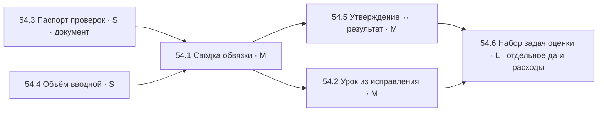

# TS-54 — Голос рынка 2: исследование Marmelab «State of AI Harness Engineering 2026» → коррекция плана Harnessy

Статус: 30.10.2026, слово владельца: «эту статью берём как исследование рынка, голос потребителя; на её базе корректируем план и начинаем следующие шаги». Черновик плана, ждёт «да» владельца по порядку задач. Воркеры на паузе с 27.10 20:15; Codex-места нельзя будить до отбоя живого прохода OMG (аккаунт OpenAI занят до утра 30.10).

Источник: François Zaninotto, Marmelab, 24.09.2026, https://marmelab.com/blog/2026/09/24/the-state-of-ai-harness-engineering-2026.html — 246 открытых проектов, 57 публикаций, только обвязки для агентов-программистов. Пост на Reddit (u/Marmelab, 30.10.2026) — пересказ этой статьи.

Предыдущее исследование рынка: TS-46 (197 высказываний пользователей, SWOT, 10 гипотез; из них в задачи ушли §4 → TS-51, §6 → TS-49, §7 → TS-50, остальные ждут живого аудита). TS-54 не повторяет TS-46: там — что видит и чувствует пользователь в окне; здесь — как устроена обвязка, что в ней реально работает по замерам.

## 1. Что говорит рынок и что у нас уже есть

Таблица сверки. «Есть» — влито в main и покрыто тестами; «нет» — в движке не найдено (проверено по `packages/*/src` на a60f760).

| № | Вывод статьи (простыми словами) | Чем подтверждён | Что у нас есть | Чего нет |
|---|---|---|---|---|
| 1 | Письменные правила почти не выполняются: из 481 файла инструкций действует 4–16 % правил. Важное правило должно быть программной проверкой, а не просьбой | arXiv 2608.23550; OpenAI; Stripe «нельзя шептать агенту» | Политика обмена `comms-policy.yaml` (кто кому что может слать), срок полномочий хода `TurnScope`, токены процессов, режимы места chat/read/check/web/ask/edit/all → канонические права провайдера, карточки подтверждения владельца, выключатель `halt.json`, песочница shell под Seatbelt, охрана настроек Gemini | У проверок нет записанной причины «какой случай её породил» и срока пересмотра (статья: без этого ни одну проверку нельзя безопасно убрать) |
| 2 | Чем меньше правил и инструментов видит модель на ход, тем лучше: Vercel −80 % инструментов → успех 80→100 %, расход ÷2, время 724→141 с. Машинно-сгенерированные инструкции хуже, чем никаких | Vercel (вторичная цифра), Microsoft Azure, ETH Zurich 138 задач | Инструменты выдаются по режиму места, не все сразу; инструкции роли отдельными файлами `roles/*.md`; состав контекста по частям показан (TS-51: инструкции, источники, сообщения, выжимка); событие сжатия | Владелец не видит, сколько инструментов и сколько строк инструкций получило место в конкретном ходе, и не может сравнить два хода |
| 3 | Правило добавлять только после реальной ошибки; источник правил — прошлые разговоры, где человек поправил модель; у правила — дата и причина; когда новая модель перестаёт ошибаться, правило убирают | flow-next (98 разборов ошибок с полем «корень» и «как предотвратить»), OpenAI «садовник документации» | `MEMORY.md` проекта с разделами (цель, ожидания, критерии, риски, решения, уроки), читается во вводные ролей; `evidence/` | Нет пути «владелец поправил модель → предложение урока с датой и ссылкой на ход». Уроки пишутся руками, без даты и источника |
| 4 | Модель сама запускает приложение, кликает, читает логи и только потом докладывает; «всё прошло» без результата выполнения не считается; успешную проверку превращать в скрипт без модели | OpenAI (приложение на каждую рабочую копию, браузер у агента, ошибка линтера содержит исправление) | Инструменты shell и web у места по режиму; worktree на место; Claude Code и Codex сами умеют запускать и проверять | В ответе модели нет связи «утверждение → результат выполнения» (TS-46 §10 ещё не в задаче); нет сохранения проверки как повторяемого скрипта |
| 5 | Измерять, что в обвязке срабатывает в живых разговорах: какие правила, сколько раз проверка что-то остановила. Делают 5 из 391 проектов | VS Code, n8n, Anthropic (не верить оценке, не прочитав стенограммы) | `TraceStore` с причинами (`owner_denied`, `approval_policy`, `rate_limited`, `provider_error`, `timeout`…), шина событий, статистика хода, минутные агрегаты сети в SQLite; пакет `analytics` в плане 0.2→0.5 | Нет сводки для владельца «как работала обвязка за неделю/проект»: сколько карточек подтверждения, отказов политики, остановок, повторов, по местам |
| 6 | Проверять саму обвязку: 20–50 замороженных задач, менять одно правило за раз, убирать по очереди и смотреть, стало ли хуже | flow-next (единственный с «до/после»), Anthropic про двусторонние проверки | Тесты продукта (3182), двусторонние тесты у охран (политика, scope, токены) | Нет набора задач для оценки пользы правил и ролей; требует живых вызовов моделей (расходы) |
| 7 | Что НЕ работает: второй агент-ревьюер −8 % успеха; команда из 4 ролей = один агент; больше 4 передач между агентами — провал; правила «спроси меня» хуже поштучного одобрения; ожидание всех проверок перед вливанием дороже дешёвого исправления | NLAH arXiv 2603.25723; SWE-bench 500; Microsoft 50 агентов → откат; 113 участников; OpenAI 1 500 PR | Автопилот с консилиумом оркестратор + ревьюер (TS-38) — ровно то, что статья называет сомнительным; очередь задач команды (TS-39); карточки подтверждения владельца на каждое рискованное действие (совпадает с выводом про поштучное одобрение) | Нет счётчика передач по задаче; владелец не видит, что задача прошла 5 рук |

## 2. Что предлагаю взять и в каком порядке

Принцип статьи и конституции владельца совпадают: скрипт измеряет и не судит, модель судит и не измеряет; правило — только в ответ на сбой; три ворот, а не церемонии. Поэтому берём не «новые правила», а **видимость и измерение**: владелец должен видеть, что обвязка делает и что она ему стоит. Это и продуктовое отличие: по статье, такое есть у единиц.

| Задача | Вывод статьи | Что сделать (кратко) | Где | Размер | Риск |
|---|---|---|---|---|---|
| **54.1 Сводка «как работала обвязка»** | 5, 7 | Из `TraceStore` и событий хода считать по проекту и периоду: карточек подтверждения (разрешено / отклонено), отказов политики, остановок владельцем, повторов, отказов провайдеров, передач между местами по задаче. Отдать окну одним маршрутом API; карточка в окне — сначала в дизайн-коде, потом живьём | runtime (счёт), api (маршрут), дизайн-код → ui/deploy | M | Счёт на лету по журналу может быть медленным на больших проектах — считать из уже существующих минутных агрегатов или кэшировать по seq. Не рисовать нули там, где данных нет |
| **54.2 Урок из исправления** | 3 | У сообщения владельца и у отклонённой карточки — действие «сделать уроком»: движок пишет в `MEMORY.md` раздел «уроки» строку с датой, проектом, ссылкой на ход и текстом владельца; владелец правит текст в карточке до записи. Без вызова модели | runtime (запись MEMORY.md под замком), api, дизайн-код → окно | M | MEMORY.md правится и руками — запись только дописыванием в раздел, под файловой блокировкой, с проверкой, что раздел есть. Не делать автоматический разбор «корня ошибки» моделью — это расходы и домыслы |
| **54.3 Паспорт проверок движка** | 1, 3 | Один файл `packages/CONTROLS.md`: по строке на каждую программную проверку (политика, scope, токены, режимы, карточки, halt, песочница, охрана Gemini): что ловит, какой случай породил (ссылка на задачу/инцидент), когда пересмотреть (например, при смене поколения моделей). Проверка без названного риска — кандидат на удаление | packages/ (документ) | S | Документ, не код; без него нельзя безопасно убирать проверки, с ним — можно. Риск: устареет, если не обновлять при каждой новой проверке — добавить строку в правила `packages/README.md` |
| **54.4 Объём вводной и инструментов в карточке хода** | 2 | В существующую карточку статистики хода (TS-40/51) добавить два числа из фактов движка: строк инструкций роли и число инструментов, выданных на ход. Чтобы владелец видел, какое место «перегружено» | runtime (уже считает состав), api, окно | S | Только факты движка; если провайдер не отдаёт список инструментов — «нет данных», не ноль |
| **54.5 Утверждение ↔ результат выполнения** | 4 | TS-46 §10: в финальном ответе связывать слова модели «тесты прошли / файл создан» с результатом выполнения инструмента в этом же ходе; без результата — не зелёная отметка, а «не подтверждено» | runtime (связь по id инструмента в ходе), окно | M | Требует, чтобы провайдеры отдавали результаты инструментов с id — есть у Claude и Codex, у части программ-провайдеров нет; тогда честное «не подтверждено» |
| **54.6 Набор задач для оценки обвязки** | 6 | 20 замороженных задач из прошлых сбоев (ошибка + ожидаемый ответ); прогон с правилом и без, модель фиксирована. Отдельный «да» владельца на расходы | tasks/eval, живые модели | L | Живые вызовы = деньги и лимиты; результат статистически слабый на 20 задачах. Ставлю последним и только по отдельному слову |

Что **не берём** из статьи: убирать ревьюера из автопилота (у нас он часто улучшает результат, как и у Atomic CRM; сначала измерить 54.1, потом решать); «цикл с обнулением контекста» (статья: не доказано, помогает запись в файлы — у нас она есть); гигантский файл правил; автоматическое написание правил моделью (ETH: хуже, чем ничего).

## 3. Порядок и зависимости

Почему так: 54.3 и 54.4 — короткие и без UI-решений, их можно делать сразу; 54.1 — главная, по ней видно, нужны ли 54.2 и 54.5 вообще и в каком объёме; 54.6 — только после того, как есть что измерять.

Исполнители по правилам 25–27.10: мелкое (54.3, 54.4) — Sonnet-субагент или воркер 2; 54.1 и 54.5 — Codex-воркеры после отбоя прохода OMG; UI-часть 54.1/54.2 — дизайн-код первым, сдача через codex-ux (четыре размера). Ворота: полный прогон с Electron, одно ревью, подпись владельца.

## 4. Риски плана целиком

- Статья меряет автономных агентов на публичных тестах; Harnessy управляет процессом с владельцем в контуре. Переносим направление, не цифры.
- Добавляя видимость (54.1, 54.4), легко уйти в «панель логов», которую TS-46 отвергла. Граница: одна карточка по запросу, не постоянная панель.
- 54.2 без дисциплины превращает MEMORY.md в свалку. Граница: только по действию владельца, только с датой и ссылкой.
